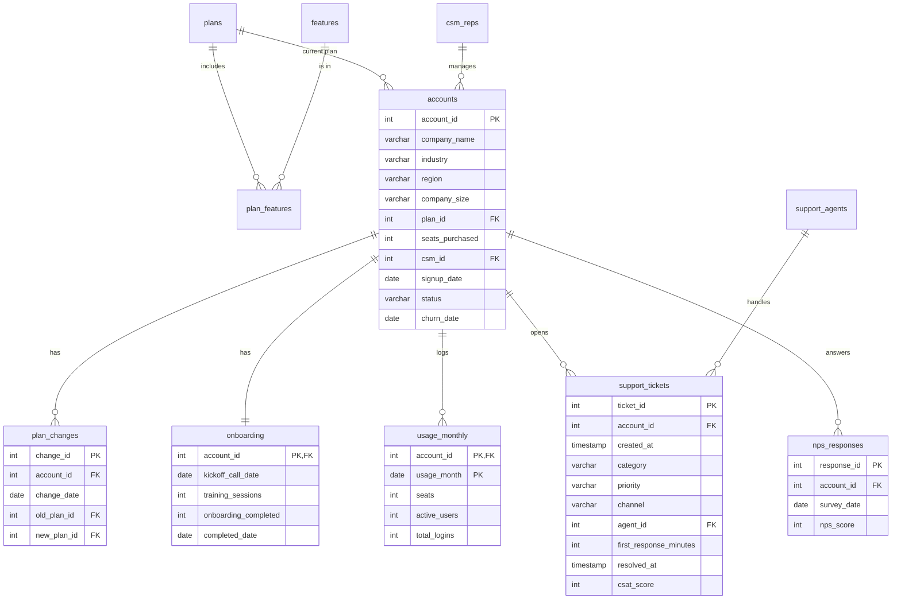

# Customer Success Analytics: Lumora (SQL / PostgreSQL)
# Author: Jane Kwon

**TL;DR:** _In progress._ Using SQL, I analyzed customers, support tickets, product usage and survey data for a SaaS company to find what drives customer churn and which accounts the Customer Success team should act on.

> **Note:** Lumora is a fictional company and all data is synthetic, generated for practice using Claude. No real customers or personal data are included. Claude was used for creating the project structure, readme, and datasets. The queries written in the queries folder, findings, and conclusions were all written and produced by me. 

---

## Business context

Lumora sells scheduling and invoicing software to small service businesses such as salons, fitness studios, dental clinics and tutoring centers. Customers pay per seat on one of three plans: **Starter**, **Growth** or **Scale**.

As a Customer Success analyst, I set out to answer questions a CS team asks every week:

- Which customers are leaving, and what do they have in common?
- Where does the support experience fall short, and does it affect retention?
- Which current customers need attention now?
- Where are the opportunities to help customers get more value?

The data snapshot is dated **2026-09-30**. All "recent" and "current" analysis is measured from that date.

## Dataset

| | |
|---|---|
| Accounts | 320 (261 active, 59 churned) |
| Support tickets | 3,373 |
| Monthly usage records | 4,581 (Jan 2025 – Sep 2026) |
| NPS survey responses | 605 |
| Tables | 11 |

Full column descriptions are in the **[data dictionary](docs/data_dictionary.md)**.

### Schema



The diagram exported from pgAdmin is in [`images/erd.png`](images/erd.png).

## Tools

- **PostgreSQL 18:** database
- **pgAdmin 4:** writing and running queries
- **Excel / Google Sheets:** charts <!-- TODO: update if you use something else -->
- **Git + GitHub Desktop:** version control

## Repository structure

```
lumora-cs-analysis/
├── README.md               ← you are here
├── findings.md             ← detailed findings log
├── setup/
│   ├── schema.sql          ← CREATE TABLE statements only (empty tables)
│   └── lumora_seed.sql     ← schema + all data (run this to rebuild everything)
├── queries/                ← one .sql file per question, numbered in order
├── docs/
│   └── data_dictionary.md  ← what every table and column means
└── images/                 ← schema diagram and charts
```

_Coming soon._

## How to reproduce

1. Install [PostgreSQL](https://www.postgresql.org/download/) (version 14 or newer).
2. Create a database:
   ```sql
   CREATE DATABASE lumora;
   ```
3. Load the schema and data. In pgAdmin, open the Query Tool on `lumora`, open `setup/lumora_seed.sql` and press F5. Or from psql:
   ```
   \c lumora
   \i setup/lumora_seed.sql
   ```
4. Verify:
   ```sql
   SELECT status, COUNT(*) FROM accounts GROUP BY status;
   -- Active 261, Churned 59
   ```
5. Run any file in [`queries/`](queries/).

The seed script uses portable SQL and also runs in MySQL 8+ and SQLite.

## Skills demonstrated


## What I learned

---

**Author:** Jane Kwon [LinkedIn](https://www.linkedin.com/in/janejkwon) 
